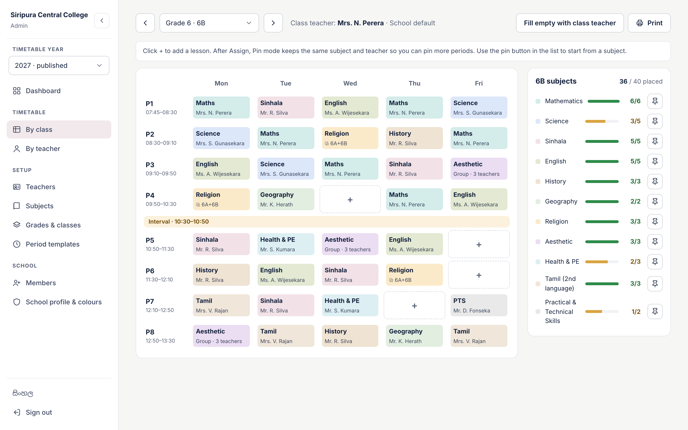
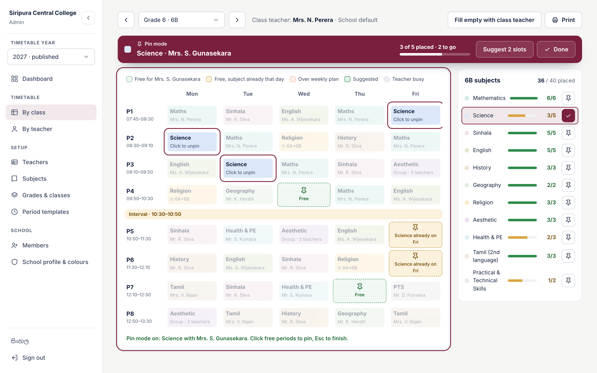
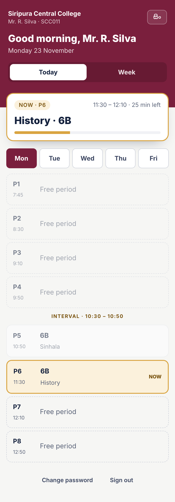

# Sathiya (සතිය)

[](https://github.com/kanushka/sathiya-lk/actions/workflows/ci.yml)
[](https://scorecard.dev/viewer/?uri=github.com/kanushka/sathiya-lk)
[](LICENSE)

A free, open-source school timetable app for Sri Lankan schools, in Sinhala and English.

School admins register their school, build class and teacher timetables, print them, and hand teachers a login slip. Teachers sign in with their staff ID and see their week on their phone. There are no fees, no paid plans and no ads.

- Website: https://sathiya.kanushka.com
- App: https://app.sathiya.kanushka.com

## Features

- **Class and teacher timetables.** Fill the week from a class grid or a teacher grid; every change shows in both. Per-grade subject plans with periods-per-week targets ("Maths 4/6") and period templates for each class.
- **Pin mode.** Pick a subject and teacher, then click slots to place lessons, with free/busy cells, load limits and suggested slots. Works for groups (e.g. Religion or Aesthetic options taught at the same time, optionally across joined classes) and from the teacher view.
- **Clash detection by clock time.** Teacher and class clashes are found by overlapping clock times, so classes on different period templates are still checked against each other.
- **A/L streams.** A class can override its grade's subject plan with its own plan.
- **Printable timetables** for every class and every teacher.
- **Teacher mobile view.** Teachers see what they teach now and next, and their week.
- **Publishing.** A timetable year stays a draft until the admin publishes it.
- **Super admin.** Moderate school registrations, handle reports of fake or duplicate schools, post announcements, maintain the default subject list and the published terms and privacy policy, and see usage per school.
- **Email.** Admin invites, school registration, verification and password reset emails (sent by a Cloud Function through the Resend API). Teachers never need an email address.
- **Bilingual.** Every screen and printout in Sinhala and English; each person picks their own language.
- **Devices.** Admin and super admin screens are made for a laptop or desktop, and tablets work too. Teachers' own timetable, the today view and sign-in work on phones.

## Screenshots

| Class view | Pin mode | Teacher (mobile) |
|---|---|---|
|  |  |  |

## Tech stack

- **Frontend:** React 18, Vite, Tailwind CSS, react-router, i18next (app); Astro (website).
- **Backend:** Firebase Auth, Cloud Firestore, Cloud Storage, Cloud Functions v2 (Node 22), App Check with reCAPTCHA Enterprise / Fraud Defense, Firebase Hosting.
- **Email:** a Firestore-triggered Cloud Function that sends through the Resend HTTP API.
- **Tooling:** pnpm workspaces, TypeScript, Vitest, Testing Library, `@firebase/rules-unit-testing`, Playwright, GitHub Actions.

## Repository layout

```
apps/app                 admin, teacher and super admin app (React + Vite)
apps/web                 public bilingual website (Astro)
functions                Cloud Functions (callables, email)
packages/core            domain logic: clashes, pin mode, plans, publishing
packages/i18n            en and si translations for the app
packages/firebase-config Firebase web configs per environment
tests/rules              Firestore and Storage security rules tests
e2e                      Playwright end-to-end tests
scripts                  local dev, seed data, licence header check
docs                     deploy, email setup, design notes
```

## Quick start

Requirements: Node 22.23.4 or later on the 22 line (see `.nvmrc`), pnpm 9, and Java 21+ for the Firebase emulators.

```bash
pnpm install
pnpm dev:local
```

`pnpm dev:local` builds the functions, starts the Firebase emulators (Auth, Firestore, Storage, Functions), seeds a demo school, then runs the app and the website. Ctrl-C stops everything. It needs ports 4000, 4321, 5001, 5173, 8080, 9099 and 9199 free.

| What | URL |
|---|---|
| App | http://localhost:5173 |
| Website | http://localhost:4321 |
| Emulator UI | http://127.0.0.1:4000 |

Demo logins. These exist only in the local emulators (defined in `scripts/seed.ts`); they are not real accounts.

| Role | Where | Login |
|---|---|---|
| School admin | `/login` → Admin login | `admin@siripura.example.com` / `admin-pass-1` |
| Teacher | `/login?as=teacher`, school "Siripura Central College" | staff ID `SCC024` / `teach234` |
| Super admin | `/login` → Admin login | `super@sathiya.example.com` / `super-pass-1` |

The seeded year is a draft, so teachers see "Not published yet" until the admin publishes it from the dashboard. `pnpm seed` re-seeds running emulators (it wipes their data first).

## Testing

```bash
pnpm test             # unit tests (Vitest) across all packages
pnpm typecheck
pnpm check:license    # every source file has the SPDX header
pnpm test:emulators   # functions and security rules tests against the emulators (needs Java)
pnpm e2e              # Playwright end-to-end tests against the emulators
```

Before the first `pnpm e2e`, install the browser once:

```bash
pnpm --filter e2e exec playwright install chromium
```

## Deploying

Production and staging are separate Firebase projects. See [docs/deploy.md](docs/deploy.md) for project setup, App Check, manual deploys and the GitHub Actions deploy workflows, and [docs/email/setup.md](docs/email/setup.md) for email.

## Contributing

Contributions are welcome, including Sinhala translation reviews. Read [CONTRIBUTING.md](CONTRIBUTING.md) and the [Code of Conduct](CODE_OF_CONDUCT.md). To report a security issue, see [SECURITY.md](SECURITY.md).

## Licence

Sathiya is licensed under the [GNU Affero General Public License v3.0 or later](LICENSE) (AGPL-3.0-or-later).

In short: you may use, study, change and share it, including running your own copy for your school or district. If you run a modified version as a service that other people use over a network, you must offer those users the complete source code of your modified version under the same licence. Keep the copyright and licence notices. The software comes with no warranty. The [LICENSE](LICENSE) file is the authoritative text.
